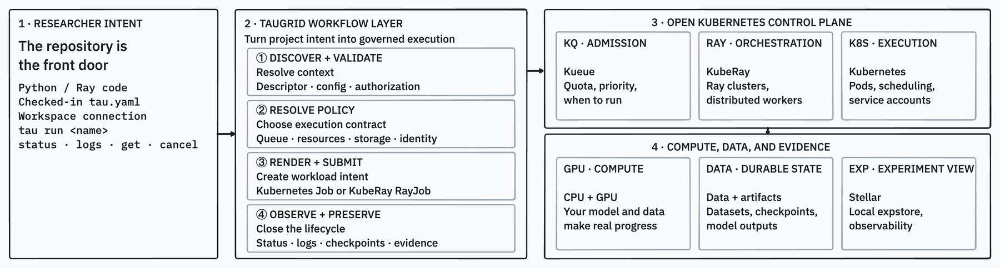
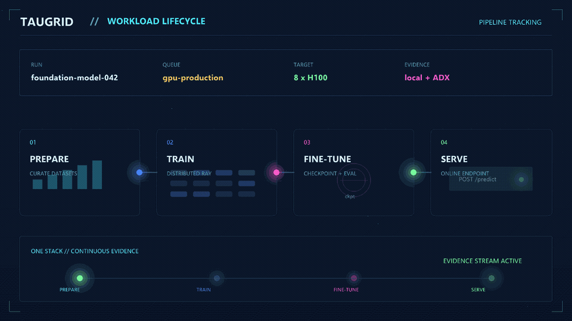
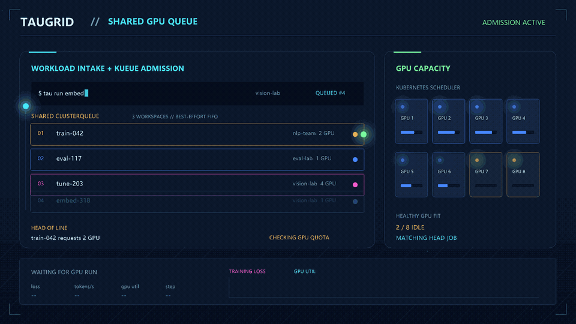

# TauGrid is now open source

Hi team,

We have open-sourced TauGrid at [github.com/Azure/taugrid](https://github.com/Azure/taugrid). TauGrid puts the `tau` CLI, Kueue queueing, KubeRay orchestration, GPU-node health monitoring, and observability into one Kubernetes-native stack for GPU workloads across data preparation, distributed training, fine-tuning, and inference. Platform teams get a single Helm install; researchers get one CLI without touching Kubernetes directly. Documentation is at [azure.github.io/taugrid](https://azure.github.io/taugrid).

## What is TauGrid?

TauGrid is an open, self-hosted AI compute platform for running AI workloads on Kubernetes. It brings the experience teams expect from a managed AI platform (simple submission, elastic distributed compute, shared GPU capacity, experiment visibility, and operational controls) to clusters they operate in their own cloud or datacenter.

Researchers work from a repository and the Tau CLI. Platform teams provide governed workspaces, queues, compute profiles, storage, identity, and observability. TauGrid ties them together so a checked-in config goes from `tau run` to queued GPU compute with status, logs, and evidence in one place.



## How it works

TauGrid uses a `tau.yaml` configuration file to describe the workload. Here is a GPU training example that runs a PyTorch workload on a single A100:

```yaml
schema_version: 1
name: aks-gpu-quickstart
run:
  entrypoint: train.py
  workload_kind: rayjob
compute:
  gpus: 1
  workers: 1
  cpus: 16
  memory: 64Gi
runtime:
  image: mcr.microsoft.com/aks/ai-runtime/ray:py3.12-ray2.56.0-cuda13.0
  pip:
    - torch>=2.4.0
```

Once submitted with `tau run`, TauGrid resolves platform policy, renders a KubeRay RayJob, and submits it through Kueue. Status, logs, checkpoints, and experiment evidence are tracked throughout the run.

The same stack covers the full GPU workload lifecycle. This animation shows a workload moving from data preparation through distributed training, fine-tuning, and into a ready inference endpoint, all with one continuous evidence record:



When multiple teams share the same cluster, their workloads enter a shared Kueue ClusterQueue. Kueue admits each job based on quota and priority, and Kubernetes places it on healthy GPUs.



## Getting started

Install the Tau CLI:

```bash
curl -fsSL https://github.com/Azure/taugrid/releases/latest/download/install.sh | sh
export PATH="$HOME/.local/bin:$PATH"
```

Install TauGrid onto your cluster:

```bash
tau cluster install
tau cluster validate installation
```

Create a workspace and run your first workload:

```bash
tau workspace create "taugrid-default" --apply
tau run --config examples/cpu-multi-interest-ray/tau.yaml
tau run status cpu-multi-interest-ray --watch
tau run logs cpu-multi-interest-ray -f
```

Full setup guide: [Getting Started on Kubernetes](https://azure.github.io/taugrid/docs/platform-admin-guide/installation-guides/kubernetes/)

## Roadmap

We are working on multi-workspace isolation, an interactive Portal, a complete dataset lifecycle, validated distributed training examples, and provider-agnostic observability. Further out, we are exploring inference support for vLLM, SGLang, and TensorRT-LLM, cross-cloud execution, and agent-driven research loops. See the full [ROADMAP.md](https://github.com/Azure/taugrid/blob/main/ROADMAP.md) for details.

---

Don't hesitate to reach out to me if you have any questions or feedback. Feel free to file issues, contribute PRs, or share ideas at [github.com/Azure/taugrid](https://github.com/Azure/taugrid).

Thanks,
Pengfei
